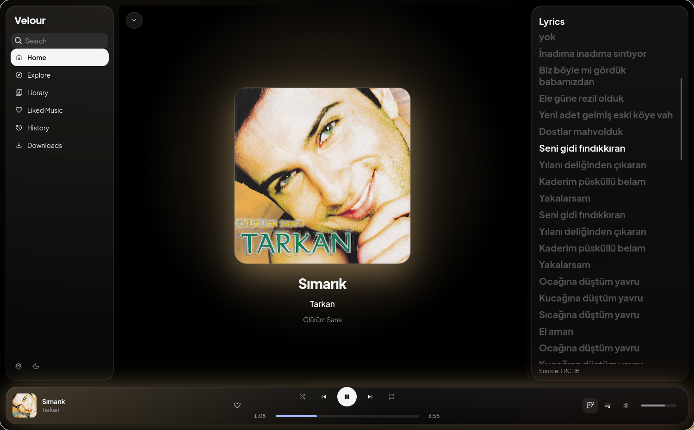
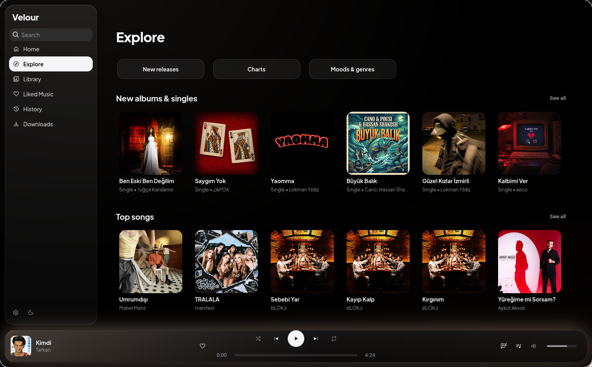
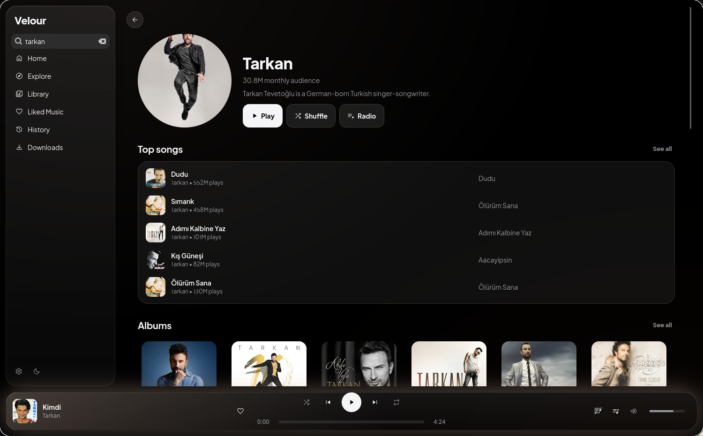
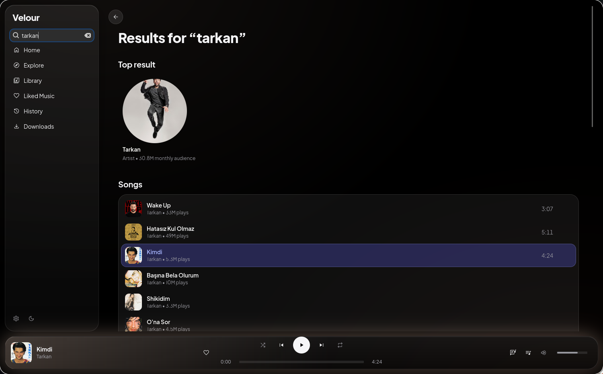
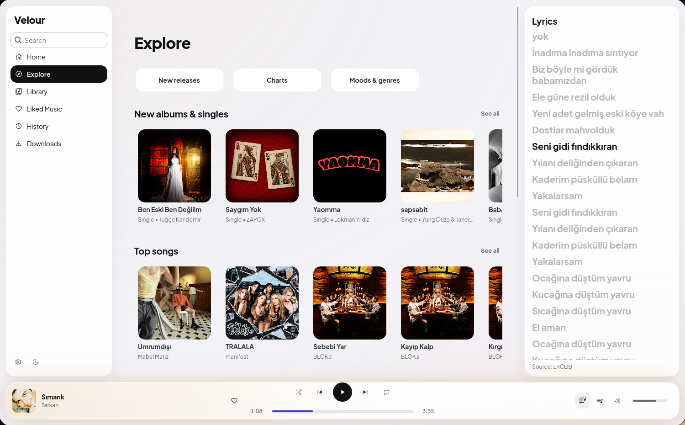

<p align="center"></p>

<h1 align="center">Velour</h1>

<p align="center">A lightweight, native desktop player for YouTube Music on Linux — GTK4, Rust and libmpv.<br>
<b>Unofficial.</b> Not affiliated with YouTube or Google. See <a href="DISCLAIMER.md">DISCLAIMER</a>.</p>

<p align="center"></p>

## Why

Most desktop YouTube Music apps wrap the website in Electron and use hundreds of megabytes and a
steady stream of CPU. Velour is a native app: its own UI, the YouTube Music data your account
already sees, and audio through libmpv.

## Features

- **Browse** — Home, Explore (new releases, charts, moods), search with suggestions, artists,
  albums, playlists, Library (playlists/albums/artists), Liked Music, History
- **Play** — gapless playback, Premium-quality audio when your account has Premium, queue with
  drag-to-reorder, shuffle/repeat, endless radio, session restore
- **Now playing** — full-size view with a glow taken from the cover art; synced lyrics (LRCLIB)
  with YouTube Music lyrics as fallback
- **Your library** — like/unlike, add/remove songs, create/rename/delete playlists, save albums,
  save the queue as a playlist; filter and sort long playlists
- **Desktop** — MPRIS (media keys, `playerctl`), keeps playing when closed, single instance,
  optional notifications, tray icon and Discord status, equalizer presets
- **Fast** — cached pages open instantly, songs are prepared when you hover them and the next song
  is resolved ahead of time
- Sign in with **Firefox, Chrome, Chromium, Brave, Edge, Vivaldi or Opera**

| | |
|---|---|
|  |  |
|  |  |

## Requirements

- Linux with **GTK ≥ 4.20**, **libmpv** and **ffmpeg** (Debian/Ubuntu: `libgtk-4-1 libmpv2 ffmpeg`)
- **[yt-dlp](https://github.com/yt-dlp/yt-dlp)** (recent; the self-updating binary is recommended)
  and a JavaScript runtime, **[deno](https://deno.com)**, in `~/.local/bin` or `PATH`
- A browser where you're signed in to music.youtube.com

Velour checks these on start and tells you if something is missing or outdated. When songs
suddenly stop playing, update yt-dlp (Settings → Playback helpers → Update, or `yt-dlp -U`).

## Install

```bash
git clone https://github.com/mikailustuner/velour && cd velour
./scripts/install.sh        # builds and installs into ~/.local (no sudo)
# or
./scripts/build-deb.sh      # builds target/deb/velour_<version>_amd64.deb
sudo apt install ./target/deb/velour_*_amd64.deb
```

Building needs Rust (stable), `pkg-config`, `libgtk-4-dev` and `libmpv-dev`. Builds run at low
CPU priority with 4 jobs so the desktop stays responsive.

## Usage

Pick your browser in **Settings → Account** (Firefox is the default). Double-click a song to play,
right-click (or ⋯) for more.

| Keys | |
|---|---|
| Space | play / pause |
| Ctrl + ← / → | previous / next |
| Shift + ← / → | seek 10 s |
| Ctrl + ↑ / ↓ | volume |
| M | mute |
| P | now playing view |
| Ctrl + L | like |
| Ctrl + F | search |
| Alt + ← | back |
| Ctrl + Q | quit |

On Hyprland, media keys work through MPRIS:
`bind = , XF86AudioPlay, exec, playerctl play-pause`.

## Resource use

Measured on a GTX 1050 Ti, release build:

| | GPU rendering (default) | Low memory mode |
|---|---|---|
| Memory (private) | ~250 MB (mostly the NVIDIA driver) | ~90 MB |
| CPU idle | ~0.4 % of one core | ~0 % |
| CPU while playing | ~2 % | ~3.3 % |
| CPU while scrolling covers | ~20 % | ~175 % |

Low memory mode (Settings, applies after restart) uses software rendering. Each new song briefly
runs yt-dlp at low priority (~4 s); hovering a song or the Play button prepares it in advance.

## Privacy

No accounts, servers, analytics or telemetry. Velour reads your browser's YouTube cookies locally
and sends them only to YouTube. Lyrics lookups send the song title, artist, album and duration to
LRCLIB. Plays are added to your YouTube Music history after 30 seconds (can be turned off).
Details: [SECURITY.md](SECURITY.md).

## Legal

Velour is an independent project and is **not affiliated with, endorsed or sponsored by YouTube,
Google LLC or Alphabet Inc.** YouTube and YouTube Music are trademarks of Google LLC. Velour does
not host or distribute any content and does not bundle yt-dlp. It uses the same internal API as
the YouTube Music website, which YouTube's Terms of Service don't permit for third-party clients:
use it with your own account, at your own risk. Offline downloads are off by default and meant
only for content you have the right to keep. Full text: [DISCLAIMER.md](DISCLAIMER.md).

## Development

```bash
cargo test --workspace                                  # unit + parser tests (public fixtures)
cargo run -p velour-ytm --example dump -- public        # refresh public fixtures (signed out)
cargo run -p velour-ytm --example dump -- private       # your own fixtures (gitignored)
cargo run -p velour-ytm --example e2e_playlist          # playlist edits on a throwaway playlist
VELOUR_AO=null cargo run -p velour                      # run without audio output
```

Crates: `crates/ytm` (YouTube Music client + parsers), `crates/player` (libmpv + yt-dlp),
`crates/app` (GTK UI). Design notes in [docs/design.md](docs/design.md). See
[CONTRIBUTING.md](CONTRIBUTING.md).

## License

[GPL-3.0-or-later](LICENSE). Third-party components: [THIRD_PARTY_NOTICES.md](THIRD_PARTY_NOTICES.md).
